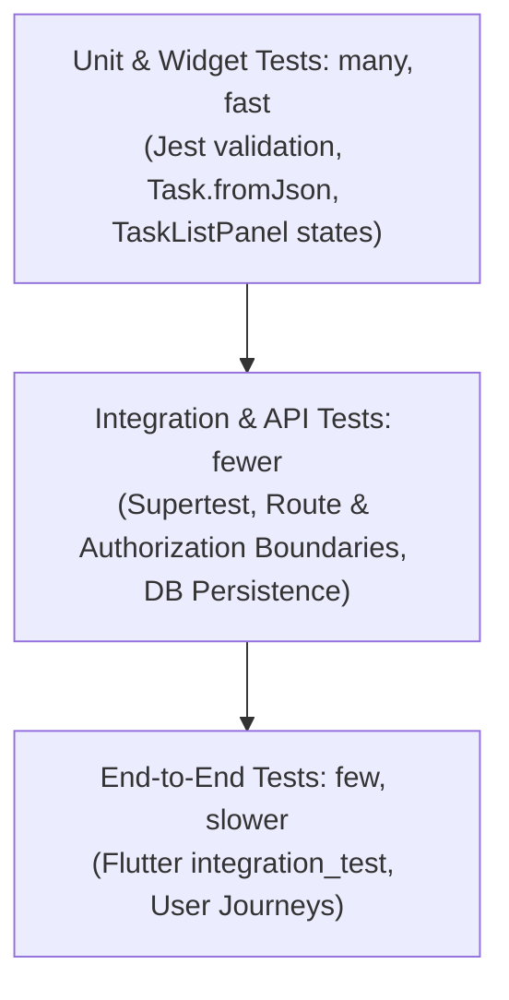

# Test Plan: Task Manager Application

Based on the hands-on testing guide for the Task Manager Application (Flutter + Node.js/Express + PostgreSQL + JWT).

## Test Plan Template

| Field | Notes |
| :--- | :--- |
| **Feature / Release** | Task Manager v1.0 (Auth, Task CRUD, Session Refresh, Security Controls) |
| **Scope** | **Included**: User registration, login, JWT access & refresh token rotation, token reuse detection, logout, logout-all, task CRUD operations strictly isolated by owner ID, title validation (1–120 characters), rate limiting on authentication routes. **Excluded**: Third-party OAuth providers, password recovery via email, file attachments, multi-tenant organization teams. |
| **Risks** | - **Data Loss / State Desynchronization**: Tasks disappearing or state changes failing to persist upon network interruption or session expiration. - **Broken Object Level Authorization (BOLA)**: Unauthorized users reading, updating, or deleting other users' tasks by manipulating `taskId` or sending custom `ownerId`. - **Broken Authentication**: Stale or reused refresh tokens allowing unauthorized session renewal. - **Resource Exhaustion**: Unbounded payload sizes or brute-force attempts against login and refresh endpoints. |
| **Test Environment** | - **Backend**: Node.js v20+, Express REST API, PostgreSQL 16 (with in-memory SQL database for hermetic unit/API tests). - **Mobile**: Flutter 3.x, Dart 3.x. - **Platforms**: Windows Desktop, Web, Android Emulator (API 34), iOS Simulator. - **Tools**: Jest, Supertest, Flutter Test, Integration Test, k6. |
| **Test Data** | Synthetic disposable user accounts (`tester@example.test`, `stranger@example.test`), synthetic task payloads with boundary strings, non-production secrets, automatic teardown between test runs. |
| **Test Types** | Unit tests, widget tests, API/integration tests, end-to-end user journeys, exploratory testing, security negative testing, load/performance testing. |
| **Entry Criteria** | Backend API builds and starts; database schema migrated; unit tests pass; mobile app compiles without analyzer warnings; dedicated test credentials available. |
| **Exit Criteria** | 100% of critical unit and widget tests pass; all Supertest API security boundaries pass (no cross-user leakage); E2E sign-in and task creation journey completes successfully; k6 load test meets latency thresholds (`p(95) < 500ms`, `rate < 0.01`). |
| **Owners** | QA Engineer, Backend Developer, Mobile Developer. |
| **Evidence** | Redacted test execution reports, sanitized terminal output, CI logs, Jest reports. No production tokens or passwords. |

---

## Testing Pyramid Overview

---

## Feature Acceptance Criteria (Example: Task Creation)

1. **Typical Success**: A task with a valid title (e.g. `"Plan tests"`) is saved, bound to the authenticated owner's `user_id`, and appears in the task list with HTTP status `201 Created`.
2. **Invalid Input**: A title containing only spaces, empty, longer than 120 characters, or of invalid type (e.g. number/boolean) is rejected with HTTP `400 Bad Request` and a clear error message (`"Enter a valid title."`).
3. **Permission Boundary**: A user cannot view, update, or delete another account's task by altering the `taskId` (returns HTTP `404 Not Found` or `403 Forbidden`).

